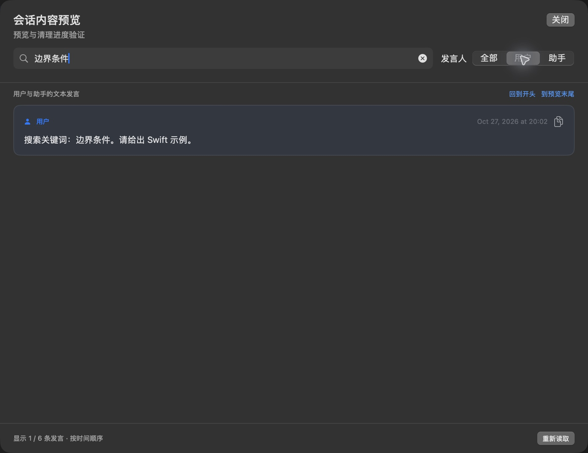
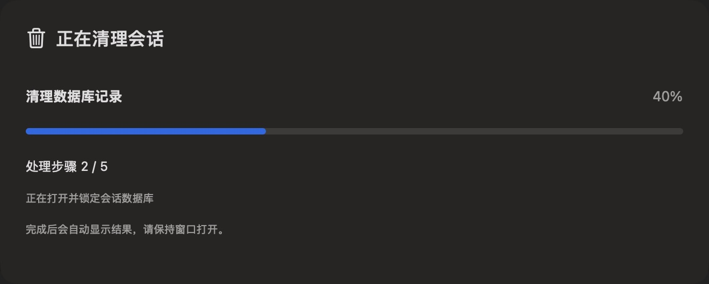

# Codex Cleaner

[](https://github.com/KaranocaVe/codex-cleaner/actions/workflows/ci.yml)
[English](README.en.md)

Codex Cleaner 是一个以 SwiftUI 和 AppKit 编写的 macOS 原生工具，用于浏览、筛选、预览和清理本机 Codex 会话索引。最低要求 macOS 14 和 Swift 6.0。当前界面为简体中文。



## 功能

- 从 Codex 状态与历史数据库读取会话，并按项目、状态、时间、模型等信息搜索和筛选。
- 以原生表格展示；支持键盘导航、多选、排序，以及项目和父子会话树。
- 树视图的家庭大小统计包含父会话及其所有后代；级联清理会在审阅范围中明确列出后代。
- 按需读取 rollout 文件，预览用户和助手正文；`.jsonl.zst` 预览可选用系统中已有的 `zstd` 命令。
- 清理前显示最终范围。清理会把匹配的 rollout 文件移到 Codex 目录内的 `Trash/CodexCleaner/`，并删除五个 Codex SQLite 库中的相关会话条目。

## 安装与构建

下载当前架构对应的 arm64 或 x86_64 app 包，请查看 [Releases](https://github.com/KaranocaVe/codex-cleaner/releases)。公开发行包使用 ad-hoc 签名，**未使用 Developer ID 签名或 Apple 公证**；macOS 可能显示首次打开提示。也可以从源码构建：

```sh
git clone https://github.com/KaranocaVe/codex-cleaner.git
cd codex-cleaner
./build-app.sh
open outputs/CodexCleaner.app
```

脚本支持 `--arch arm64|x86_64` 和 `--output <path>`。需要 Xcode Command Line Tools 与 Swift 6.0 或更新版本。应用默认读取 `$CODEX_HOME` 指定的目录；未设置时读取 `~/.codex`。从 Finder 启动时通常不会继承终端中的环境变量。

`zstd` 仅用于预览压缩 rollout，不是构建或浏览未压缩会话所必需的依赖。可通过 Homebrew 安装：`brew install zstd`。

## 清理之前请先了解

清理是破坏性操作。应用**不会备份数据库**。它会将所选会话的 `.jsonl` / `.jsonl.zst` rollout 文件移动到同一磁盘的 Codex Trash 目录，并在五个 SQLite 数据库中清理该会话相关的索引、父子关系、历史、日志、目标、队列和读取游标。没有关联的既有孤立记录不会因清理而删除。

数据库事务提交后，索引删除没有应用内撤销功能；保留的 rollout 文件不足以完整恢复数据库状态。移动到 Trash 不会释放磁盘空间，文件大小仍被占用，数据库也不会自动执行 `VACUUM`。如果清理失败，应用会尝试回滚数据库事务并恢复已移动的文件，但不能把跨多个 WAL 数据库的提交保证为断电时全局原子操作。清理前请停止相关会话，并仔细核对最终审阅范围。



完整说明见 [清理与恢复边界](docs/cleanup-and-recovery.md)。

## 测试

```sh
swift test
```

版本 0.2.3 的测试套件包含 39 项测试。默认测试使用隔离的临时数据库与文件；其中 3 项真实数据只读检查默认跳过。只有明确希望读取当前 Codex 数据时，才设置 `CODEX_CLEANER_TEST_REAL_DATA=1` 运行 opt-in 检查；这些检查只读，不执行清理。

## 贡献与安全

贡献方式见 [CONTRIBUTING.md](CONTRIBUTING.md)。安全漏洞请使用 GitHub 的[私密漏洞报告](https://github.com/KaranocaVe/codex-cleaner/security/advisories/new)，不要在公开 issue 中附加数据库、rollout、日志或其他个人会话内容。

## 版本与许可证

当前版本：0.2.3（build 5）。变更记录见 [CHANGELOG.md](CHANGELOG.md)。项目采用 MIT License，详见仓库中的 `LICENSE` 文件。
